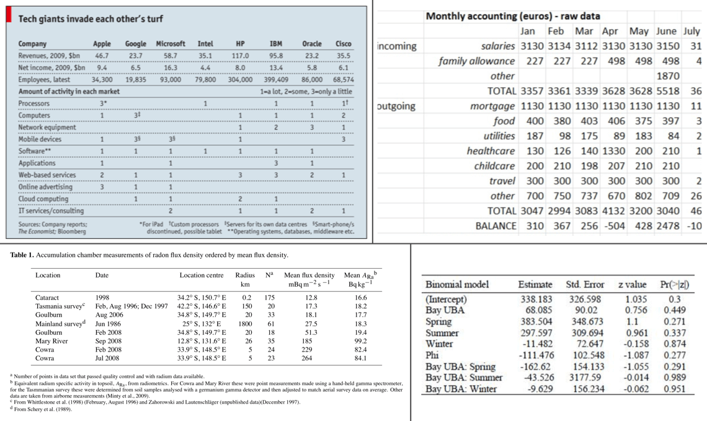
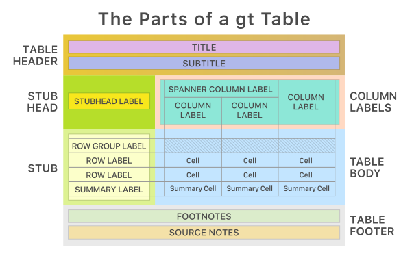

# Introduction

The **Great Tables** package is all about making it simple to produce nice-looking display tables. Display tables? Well yes, we are trying to distinguish between data tables (i.e., DataFrames) and those tables you'd find in a web page, a journal article, or in a magazine. Such tables can likewise be called presentation tables, summary tables, or just tables really. Here are some examples, ripped straight from the web:



A collage of display tables taken from web pages, articles, and magazines.

Display tables exist because raw DataFrames are working artifacts, not communication tools. When you share findings with colleagues, stakeholders, or readers, the formatting of your table directly affects how well your message lands. Good structure and styling reduce cognitive load, draw attention to what matters, and help your audience reach the right conclusions faster. A well-built table is an act of respect for your reader's time.

We can think of display tables as output only, where we'd not want to use them as input ever again. Other features include annotations, table element styling, and text transformations that serve to communicate the subject matter more clearly.

## Let's Install

The installation really couldn't be much easier. Use this:

``` bash
pip install great_tables
```

Once installed, you are ready to build your first table.

## A Basic Table using **Great Tables**

Let's use a subset of the [countrypops](../reference/data.countrypops.md#great_tables.data.countrypops) dataset available within `great_tables.data`, keeping the ten most populous countries in 2022:

``` python
import polars as pl
from great_tables import GT, data

countries_mini = (
    data.pl.countrypops.filter(pl.col("year") == 2022)
    .sort("population", descending=True)
    .head(10)
    .select("country_name", "population")
)
```

The `countries_mini` data is a simple **Polars** DataFrame with 2 columns and that'll serve as a great start. Speaking of which, the main entry point into the **Great Tables** API is the [GT](../reference/GT.md#great_tables.GT) class. Let's use that to make a presentable table:

``` python
# Create a display table showing the ten most populous countries
gt_tbl = GT(countries_mini)

# Show the output table
gt_tbl
```

| country_name       | population |
|--------------------|------------|
| India              | 1417173173 |
| China              | 1412175000 |
| United States      | 333287557  |
| Indonesia          | 275501339  |
| Pakistan           | 235824862  |
| Nigeria            | 218541212  |
| Brazil             | 215313498  |
| Bangladesh         | 171186372  |
| Russian Federation | 143555736  |
| Mexico             | 127504125  |

That doesn't look too bad! Sure, it's basic but we really didn't ask for much. We did receive a proper table with column labels and the data. Even this minimal output is an improvement over a raw DataFrame: you get proper HTML rendering, consistent spacing, and a clean visual structure that works in notebooks, reports, and web pages alike. But the real power of Great Tables comes from layering on the structural components described next. Oftentimes, you'll want a bit more: a **Table Header**, a **Stub**, and sometimes *source notes* in the **Table Footer** component.

> **Note**
>
> Typically we use Great Tables in a notebook environment or within a Quarto document. Tables won't print to the console, but using the [show()](../reference/GT.show.md#great_tables.GT.show) method on a table object while in the console will open the HTML table in your default browser.

## **Polars**, **Pandas**, and **PyArrow** support

[GT](../reference/GT.md#great_tables.GT) accepts **Polars** and **Pandas** DataFrames, as well as **PyArrow** tables, and none of these libraries is a hard requirement: install whichever one you already use. Supporting several backends matters because teams often have mixed workflows, and you shouldn't have to rewrite your table code just because a project uses a different DataFrame library. This User Guide mostly uses **Polars**, but the table-building code is the same whichever DataFrame you start from.

A **Polars** DataFrame can also be turned into a table through its `DataFrame.style` property:

``` python
# Approach 1: call GT ----
GT(countries_mini)

# Approach 2: Polars style property ----
countries_mini.style
```

| country_name       | population |
|--------------------|------------|
| India              | 1417173173 |
| China              | 1412175000 |
| United States      | 333287557  |
| Indonesia          | 275501339  |
| Pakistan           | 235824862  |
| Nigeria            | 218541212  |
| Brazil             | 215313498  |
| Bangladesh         | 171186372  |
| Russian Federation | 143555736  |
| Mexico             | 127504125  |

> **Note**
>
> The `polars.DataFrame.style` property is currently considered [unstable](https://docs.pola.rs/api/python/stable/reference/dataframe/style.html#polars.DataFrame.style), and may change in the future. Using [GT](../reference/GT.md#great_tables.GT) on a **Polars** DataFrame will always work.

What `.style` gives you is a [GT](../reference/GT.md#great_tables.GT) table, so anything you'd do to a [GT](../reference/GT.md#great_tables.GT) table can follow it. That includes making it interactive: [GTI.from_gt()](../reference/GTI.from_gt.md#great_tables.GTI.from_gt) turns it into a [GTI](../reference/GTI.md#great_tables.GTI) table, which readers can sort, search, and page through (see [Interactive Tables](interactive-tables.md)).

``` python
from great_tables import GTI

GTI.from_gt(countries_mini.style.fmt_integer(columns="population"))
```

| country_name       | population    |
|--------------------|---------------|
| India              | 1,417,173,173 |
| China              | 1,412,175,000 |
| United States      | 333,287,557   |
| Indonesia          | 275,501,339   |
| Pakistan           | 235,824,862   |
| Nigeria            | 218,541,212   |
| Brazil             | 215,313,498   |
| Bangladesh         | 171,186,372   |
| Russian Federation | 143,555,736   |
| Mexico             | 127,504,125   |

## Some Beautiful Examples

In the following pages we'll use **Great Tables** to turn DataFrames into beautiful tables, like the ones below.

``` python
import polars as pl
from great_tables import GT, data, md

countries_mini = (
    data.pl.countrypops.filter(pl.col("year") == 2022)
    .sort("population", descending=True)
    .head(10)
    .select("country_name", "population")
)

(
    GT(countries_mini, rowname_col="country_name")
    .tab_header(
        title="The World's Most Populous Countries",
        subtitle="The top ten in 2022 are presented"
    )
    .fmt_integer(columns="population")
    .tab_source_note(
        source_note="Total population counts all residents regardless of legal status or citizenship."
    )
    .tab_source_note(
        source_note=md("Source: [The World Bank](https://data.worldbank.org/indicator/SP.POP.TOTL).")
    )
    .tab_stubhead(label="country")
)
```

| The World's Most Populous Countries |  |
|----|----|
| The top ten in 2022 are presented |  |
| country | population |
| India | 1,417,173,173 |
| China | 1,412,175,000 |
| United States | 333,287,557 |
| Indonesia | 275,501,339 |
| Pakistan | 235,824,862 |
| Nigeria | 218,541,212 |
| Brazil | 215,313,498 |
| Bangladesh | 171,186,372 |
| Russian Federation | 143,555,736 |
| Mexico | 127,504,125 |
| Total population counts all residents regardless of legal status or citizenship. |  |
| Source: [The World Bank](https://data.worldbank.org/indicator/SP.POP.TOTL). |  |

``` python
from great_tables import GT, data, html

gibraltar_m = data.pl.gibraltar.head(10).select(
    "date", "time", "temp", "humidity", "wind_speed", "pressure"
)

gt_gibraltar = (
    GT(gibraltar_m)
    .tab_header(
        title="Weather at Gibraltar Airport",
        subtitle="Observations from the early hours of May 1, 2023",
    )
    .tab_spanner(label="Observed", columns=["date", "time"])
    .tab_spanner(label="Measurement", columns=["temp", "humidity", "wind_speed", "pressure"])
    .fmt_percent(columns="humidity", decimals=0)
    .cols_label(
        date="Date",
        time="Time",
        temp=html("Temp,<br>&deg;C"),
        humidity="Humidity",
        wind_speed=html("Wind,<br>m/s"),
        pressure=html("Pressure,<br>hPa"),
    )
)

gt_gibraltar
```

[TABLE]

These examples show just a glimpse of what's possible with **Great Tables**. The rest of this User Guide will walk you through each capability in detail, from structuring your table with headers, stubs, and column labels, to formatting values, adding visual styles, and embedding nanoplots directly in your cells.

## The Anatomy of a Table

Every table produced by **Great Tables** is composed of a set of structural components. Understanding these components and how they relate to each other is key to building effective presentation tables.

The **Great Tables** package makes it relatively easy to add components so that the resulting output table better conveys the information you want to present. These table components work well together and the possible variations in arrangement can handle even the most demanding table presentation needs. The previous output table we showed had only two components: the **Column Labels** and the **Table Body**. The next few examples will show all of the other table parts that are available.

This is the way the main parts of a table (and their subparts) fit together:



A diagram of the parts of a table: the Table Header, the Stub and Stub Head, the Column Labels, the Table Body, and the Table Footer.

The following list describes each major component of a **Great Tables** output, ordered from top to bottom:

- the **Table Header** (optional, with a **title** and possibly a **subtitle**)
- the **Stub** and the **Stub Head** (optional, contains *row labels*, optionally within *row groups* having *row group labels*)
- the **Column Labels** (contains *column labels*, optionally under *spanner labels*)
- the **Table Body** (contains *columns* and *rows* of *cells*)
- the **Table Footer** (optional, possibly with one or more **source notes**)

Not every table needs every component. A simple table may only require column labels and a body, and that is perfectly fine. The components listed above are opt-in: you add whichever ones help your reader understand the data, and leave the rest out. A title might be essential for a published report but unnecessary in an exploratory notebook. Source notes matter when provenance is important but can be skipped for internal dashboards. Let the context guide your choices.

Each of these parts is covered in detail throughout the rest of this User Guide. The pages that follow will show you how to add a header and footer, create a stub with row labels and groupings, organize your column labels with spanners, format cell values, and apply styling to any part of the table.
