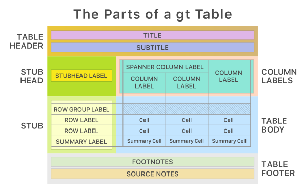

When you need to apply broad visual changes across an entire table, `~~GT.tab_options()` is the
right tool. Rather than styling individual cells or specific locations, this method lets you set
colors, fonts, borders, and spacing for entire table parts in a single call. This page explains the
structure of option names, demonstrates how to style different parts, and shows how to build a
complete table theme.

```{=html}
<script src="../assets/tabblen.js" defer></script>
<gt-tabblen float="right" arms="rest up" cells="mfr|model|hp|msrp/Ford|GT|647|447k/Audi|R8|610|169k" cell-trick="options" intro='[["say", "So many options to set!"], ["mood", "grin"], ["wait", 400], ["mood", "happy"]]'></gt-tabblen>
```

A useful way to think about the relationship between `~~GT.tab_options()` and `~~GT.tab_style()`:
use `tab_options()` when you want to set broad defaults for entire table parts (e.g., "all column
labels should have this background color"). Use `tab_style()` when you need to target specific
cells, columns, or rows. The two work together naturally: `tab_options()` sets the base theme, and
`tab_style()` applies targeted overrides on top of it.

Great Tables exposes options to customize the appearance of tables via two methods:

* `~~GT.tab_style()`: targeted styles (e.g., color a specific cell of data, or a specific group
label).
* `~~GT.tab_options()`: broad styles (e.g., color the header and source notes).

Both methods target parts of the table, as shown in the diagram below.



This page covers how to style and theme your table using `~~GT.tab_options()`, which is meant to
quickly set a broad range of styles.

We'll use the basic GT object below for most examples, since it marks some of the table parts.

```{python}
import polars as pl
from great_tables import GT, data

gt_ex = (
    GT(data.pl.exibble.head(5), rowname_col="row", groupname_col="group")
    .tab_header("THE HEADING", "(a subtitle)")
    .tab_stubhead("THE STUBHEAD")
    .tab_source_note("THE SOURCE NOTE")
    .grand_summary_rows(fns={"GRAND SUMMARY ROW": pl.col("num", "currency").sum()})
)

gt_ex
```

## Table Option Parts

As the diagram above showed, tables are made of many parts. These include the heading, column
labels, and the stub. `~~GT.tab_options()` organizes options based on table part.

The code below illustrates the table parts `~~GT.tab_options()` can target, by setting the
background color for various parts.

```{python}
(
    gt_ex
    .tab_options(
        container_width="100%",
        table_background_color="lightblue",
        heading_background_color="gold",
        column_labels_background_color="aquamarine",
        row_group_background_color="lightyellow",
        stub_background_color="lightgreen",
        source_notes_background_color="#f1e2af",
        grand_summary_row_background_color="lightpink",
    )
)
```

Notice two important pieces:

* The argument `heading_background_color="gold"` sets the heading part's background to gold.
* Parts like `container` and `table` are the broadest. They cover all the other parts of the table.

## Finding Options: Part, Type, Attribute

Option names in `~~GT.tab_options()` follow a consistent naming convention. Understanding the
pattern makes it easy to find the exact option you need without searching through documentation. The
format is:

```text
{part name}_{type}_{attribute}
```

For example, the option `row_group_border_top_color` has these pieces:

* **part**: `row_group`
* **type**: `border_top`
* **attribute**: `color`

:::{.callout-note}
Here are the parts supported in `~~GT.tab_options()`:

* `container`, `table`
* `heading`, `column_labels`, `row_group`
* `stub`, `stub_row`, `table_body`, `data_row`
* `summary_row`, `grand_summary_row`
* `footnotes`, `source_notes`
* `row_striping`

There are also `quarto` and `ihtml` options, which control Quarto integration and interactive
tables rather than a visible table part.
:::

## Styling Borders

Many table parts support customizing border colors and style. This is shown below for column
labels.

```{python}
gt_ex.tab_options(
    column_labels_border_top_color="blue",
    column_labels_border_top_style="solid",
    column_labels_border_top_width="5px"
)
```

The column labels section now has a thick blue border on top. Each border option follows the same
triplet of `color`, `style`, and `width` attributes, which you can combine to create the exact look
you want.

## Styling Background Color

```{python}
gt_ex.tab_options(
    heading_background_color="purple"
)
```

The heading area (title and subtitle) is now purple. Background color options are available for
every table part, letting you assign a distinct visual identity to each region.

## Styling Body Cells

The table body can style the lines between individual cells. Use the `hlines` and `vlines` option
types to specify cell line color, style, and width.

For example, the code below changes horizontal lines (`hlines`) between cells to be red, dashed
lines.

```{python}
gt_ex.tab_options(
    table_body_hlines_color="red",
    table_body_hlines_style="dashed",
    table_body_hlines_width="4px",
)
```

In order to define the vertical lines between cells, set `vlines` styles. For example, the code
below makes both horizontal and vertical lines between cells solid.

```{python}
gt_ex.tab_options(
    table_body_hlines_style="solid",
    table_body_vlines_style="solid",
)
```

With both `hlines` and `vlines` set to solid, the table body displays a classic grid appearance.
Setting either to `"none"` removes those lines entirely for a cleaner, minimal look.

## Set Options Across Table Parts

Some options starting with `table_` apply to all parts of the table. For example, fonts and
background color apply everywhere.

```{python}
gt_ex.tab_options(
    table_background_color="green",
    table_font_color="darkblue",
    table_font_style="italic",
    table_font_names="Times New Roman"
)
```

Options set across the whole table can be overridden by styling a specific part.

```{python}
gt_ex.tab_options(
    table_background_color="orange",
    heading_background_color="pink"
)
```

The orange background applies everywhere except the heading, which overrides it with pink. This
layered approach means you can set sensible table-wide defaults and then customize individual parts
as needed.

If you find yourself applying the same `~~GT.tab_options()` settings across multiple tables,
consider wrapping them in a function. This ensures visual consistency and lets you update the theme
in one place. The next page on [Premade Themes](./16-premade-themes.qmd) shows exactly how this
works with the `opt_*()` convenience methods, which are essentially pre-built theme functions that
are included in **Great Tables**.

## A Basic Theme

Based on the sections above, we can design an overall theme for a table.

This requires setting a decent number of options, but it makes a big difference when presenting a
table! Below is a table with a simple, blue theme. (The code is hidden by default, but can be
expanded to see all the options set.)

```{python}
#| code-fold: true
(
    GT(data.pl.exibble, rowname_col="row", groupname_col="group")
    .tab_header("THE HEADING", "(a subtitle)")
    .tab_stubhead("THE STUBHEAD")
    .tab_source_note("THE SOURCE NOTE")
    .tab_options(
        # table ----
        table_border_top_color="#004D80",
        table_border_bottom_color="#004D80",

        # heading ----
        heading_border_bottom_color="#0076BA",

        # column labels ----
        column_labels_border_top_color="#0076BA",
        column_labels_border_bottom_color="#0076BA",
        column_labels_background_color="#FFFFFF",

        # row group ----
        row_group_border_top_color="#0076BA",
        row_group_border_bottom_color="#0076BA",

        # stub ----
        stub_background_color="#0076BA",
        stub_border_style="solid",
        stub_border_color="#0076BA",

        # table body ----
        table_body_border_top_color="#0076BA",
        table_body_border_bottom_color="#0076BA",
        table_body_hlines_style="none",
        table_body_vlines_style="none",
    )
)
```

With `~~GT.tab_options()`, you can define the visual identity of your tables at a broad level. The
structured naming convention makes it straightforward to find and set the options you need, and by
combining multiple options together, you can build reusable themes that give all your tables a
consistent, polished appearance.

When the option you need doesn't exist, `~~GT.opt_css()` lets you add your own CSS rules to the
table. Give the table an ID with `~~GT.with_id()` (or `GT(id=...)`) so that the rules can be scoped
to it without affecting other tables on the page.

To give a table a reusable theme, with colors that follow light and dark pages, see [Themes and Dark Mode](./29-themes-and-dark-mode.qmd).
