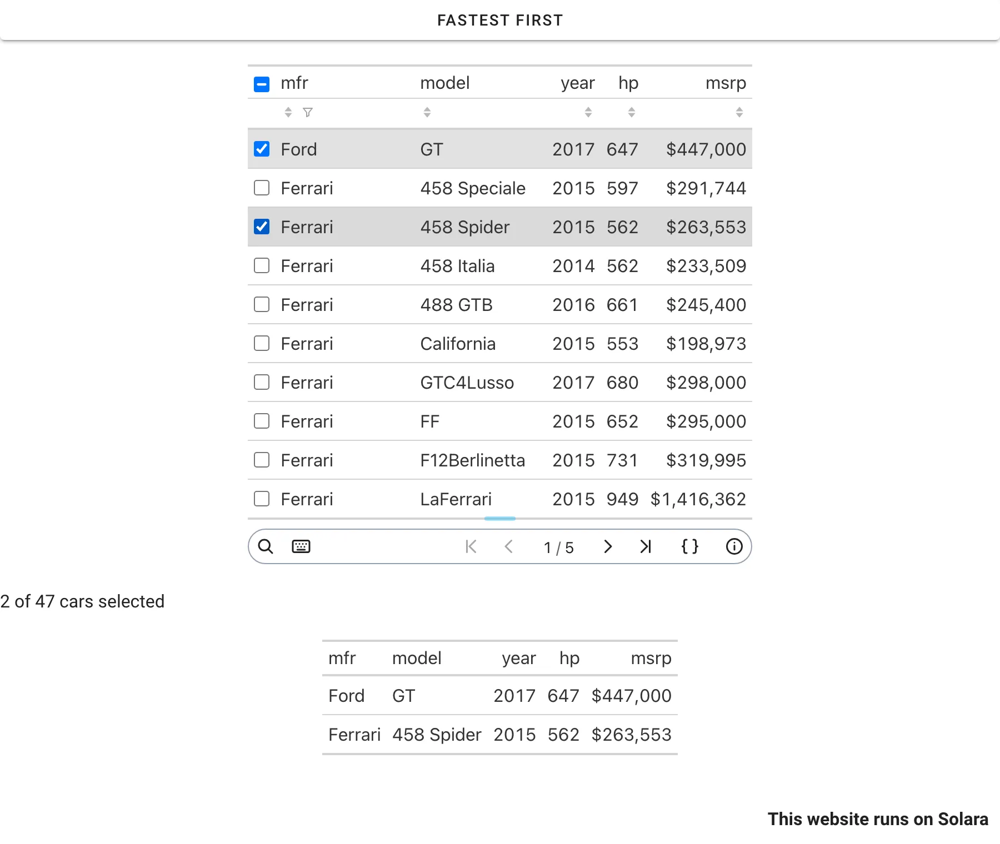
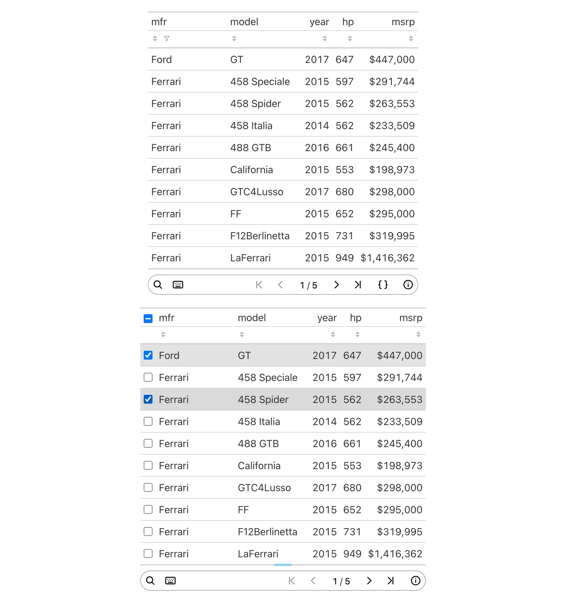

An interactive table works in the browser on its own, but Python can also read what readers do with
it, and change it: in a notebook, with a `GTI` table (see [GTI Tables](26-gti-tables.qmd)) as a
widget; in a marimo notebook or app, as a UI element; and in Shiny, Streamlit, Panel and Solara
apps. These take a `GTI` table or a `GT` table with `opt_interactive()`, get its view and
selection, and can set them. A page an app makes itself (with Flask, Django or FastHTML) shows
the table as it works in the browser, with its runtime included once, however many tables the page
has. The notebook, marimo, Streamlit and Panel examples can each be run here, in the browser,
without installing anything; the Solara and Flask apps, which need a server, are shown as they look
when they're run.

```{=html}
<script src="../assets/tabblen.js" defer></script>
<script src="../assets/gt-demo.js" defer></script>
<gt-tabblen float="right" mood="happy" arms="point rest" cells="mfr|model|hp|mpg_c/BMW|i8|357|28/Ford|GT|647|11" cell-trick="select" intro='[["say", "Python can see what you pick!"], ["mood", "grin"], ["wait", 400], ["mood", "happy"]]'></gt-tabblen>
```

## Using the table from Python

In a notebook, `~~GTI.i_as_widget()` shows the table as a widget (with
[anywidget](https://anywidget.dev), installed with `pip install great_tables[widget]`), whose view
and selection Python can read and set: what the reader searched for, filtered and sorted by, the
rows that leaves, and the rows they selected. The table still works in the browser; the widget
tells Python what it shows.

```python
from great_tables import GT, GTI, data

cars = data.gtcars[["mfr", "model", "year", "hp", "msrp"]]
widget = (
    GTI(cars)
    .fmt_integer("hp")
    .fmt_currency("msrp", decimals=0)
    .i_cols_filter(columns="mfr", type="facet")
    .i_selection("multiple")
    .i_as_widget()
)
widget
```

Then, in another cell (as the browser gives Python the table's state once the cell is done), the
cars selected, as a table of their own:

```python
chosen = widget.view(selected=True)
print(f"{len(chosen)} of {len(widget.rows)} cars selected")
GT(chosen).fmt_integer("hp").fmt_currency("msrp", decimals=0)
```

`widget.query` is the filters, as a query in text (e.g., `'mfr in ("Ferrari")'`), `widget.search`
the search and `widget.sort` the sort (e.g., `["-hp"]`). `widget.rows` is the data rows kept, in
the order shown (numbered from 0), and `widget.view()` gives those rows as a DataFrame of the data's
library (and `widget.view(selected=True)` the rows selected). Setting `query`, `search`, `sort` or
`selection` changes the table as shown:

```python
widget.query = 'mfr in ("Ferrari", "Lamborghini")'
widget.sort = "-hp"
widget.selection = []
```

`widget.on_change(callback)` calls `callback(widget)` after each change the reader makes. A change
made from Python is applied by the browser after the cell runs, so ask for the rows it leaves in
another cell.

Here's that notebook, run in the browser (in [JupyterLite](https://jupyterlite.readthedocs.io),
with these docs' Great Tables). Run its cells in turn, select a few cars, and then run the cells
below the table. It's also in Great Tables' repository, as
[`demos/widget/cars.ipynb`](https://github.com/posit-dev/great-tables/blob/main/demos/widget/cars.ipynb),
which can be
[opened in Colab](https://colab.research.google.com/github/posit-dev/great-tables/blob/main/demos/widget/cars.ipynb).

```{=html}
<gt-demo src="../demos/widget/notebooks/index.html?path=_notebooks/cars.ipynb" poster="../assets/demos/widget.webp" height="900" label="The notebook" size="35 MB" action="Open this notebook"></gt-demo>
```

## Using the table in a marimo notebook or app

In a [marimo](https://marimo.io) notebook (or one run as an app), `mo_gti()`, from
`great_tables.marimo` (installed with `pip install great_tables[marimo]`), shows an interactive
table (a `GTI` table, or a `GT` table with `opt_interactive()`) as a UI element, like marimo's own.
Assigned to a variable, the cells that read it run again with each change the reader makes. Its
`value` is a dict of the table's `"query"`, `"search"` and `"sort"`, the data `"rows"` kept (in
the order shown) and the rows in its `"selection"`. Setting the element's `query`, `search`, `sort`
or `selection` (as in a button's `on_click=`) changes the table, and the cells that read it then
run again.

```python
import marimo as mo

from great_tables import GT, GTI, data
from great_tables.marimo import mo_gti

cars = data.gtcars[["mfr", "model", "year", "hp", "msrp"]]
table = mo_gti(
    GTI(cars)
    .fmt_integer("hp")
    .fmt_currency("msrp", decimals=0)
    .i_cols_filter(columns="mfr", type="facet")
    .i_selection("multiple")
)
table
```

Then, in other cells, a button that sorts the table by horsepower, and the cars selected, as a
table of their own:

```python
def fastest(_):
    table.sort = "-hp"
    table.selection = []

fastest_button = mo.ui.button(label="Fastest first", on_click=fastest)
fastest_button
```

```python
chosen = table.view(selected=True)
mo.vstack(
    [
        mo.md(f"{len(chosen)} of {len(table.value['rows'] or [])} cars selected"),
        GT(chosen).fmt_integer("hp").fmt_currency("msrp", decimals=0),
    ]
)
```

Here's that notebook, run as an app in the browser (with marimo's WebAssembly export, and these
docs' Great Tables). Select a few cars, filter by manufacturer, or click "Fastest first":

```{=html}
<gt-demo src="../demos/marimo/" poster="../assets/demos/marimo.webp" height="760" label="The marimo notebook" size="40 MB"></gt-demo>
```

`table.view()` gives the rows kept as a DataFrame of the data's library (and
`table.view(selected=True)` the rows selected). The rows are found by the browser, as the table
works there. Before the table is shown, Python finds them, except for a `GT` table with
`opt_interactive()` or a table that starts with a search: their rows are `None` until the browser
has shown the table. They're also `None` after the table's view is set (as by the button), until
the browser has applied it. Running the table's cell again makes a new table, which starts as it's
made. A table whose rows are kept in Python (with `~~GTI.i_scale()`) asks the notebook for each
page instead, and its rows are always found in Python.

## Using the table in a Shiny app

In a [Shiny](https://shiny.posit.co/py/) app, an interactive table (a `GTI` table, or a `GT` table
with `opt_interactive()`) rendered with `render_gt()`, from `great_tables.shiny`, gives the server
its state as inputs, named after the output: `input.<id>_view()` (a dict with the `"query"`,
`"search"`, `"sort"`, `"page"`, `"page_size"`, `"hidden"` columns and `"group_by"` column),
`input.<id>_rows()` (the data rows kept, in the order shown) and `input.<id>_selection()` (the rows
selected). `update_gti()` sets its query, search, sort and selection from the server.

```python
from shiny import App, reactive, render, ui
from great_tables import GTI, data
from great_tables.shiny import output_gt, render_gt, update_gti

app_ui = ui.page_fluid(
    ui.input_action_button("fastest", "Fastest first"),
    output_gt("cars"),
    ui.output_text("chosen"),
)


def server(input, output, session):
    @render_gt
    def cars():
        return (
            GTI(data.pl.gtcars.select(["mfr", "model", "year", "hp", "msrp"]))
            .i_cols_filter(columns="mfr", type="facet")
            .i_selection("multiple")
        )

    @render.text
    def chosen():
        rows = input.cars_selection()
        return f"{len(rows)} of {len(input.cars_rows())} cars selected"

    @reactive.effect
    @reactive.event(input.fastest)
    def _():
        update_gti("cars", sort="-hp", selection=[])


app = App(app_ui, server)
```

The table works in the browser as it does anywhere else, so the server isn't asked for each page,
sort or search; a table rendered again starts with the view it's given.

## Using the table in a Streamlit app

In a [Streamlit](https://streamlit.io) app, `st_gti()`, from `great_tables.streamlit` (installed
with `pip install great_tables[streamlit]`), shows an interactive table (a `GTI` table, or a `GT`
table with `opt_interactive()`) and gives its state: its `query`, `search` and `sort`, the data
`rows` kept (in the order shown) and the rows in its `selection`. Each change the reader makes runs
the app again, with the table's new state. `update_gti()`, called in a widget's callback, sets its
query, search, sort and selection from the app. Here, the cars selected are charted, and shown as a
table of their own (a `GT` table's HTML, with `st.html()`):

```python
import streamlit as st

from great_tables import GT, GTI, data
from great_tables.streamlit import st_gti, update_gti

cars = data.gtcars[["mfr", "model", "year", "hp", "msrp"]]

st.button("Fastest first", on_click=update_gti, args=("cars",), kwargs={"sort": "-hp"})
table = (
    GTI(cars)
    .fmt_integer("hp")
    .fmt_currency("msrp", decimals=0)
    .i_cols_filter(columns="mfr", type="facet")
    .i_selection("multiple")
)
state = st_gti(table, key="cars")
st.write(f"{len(state.selection)} of {len(state.rows or [])} cars selected")

chosen = cars.iloc[state.selection]
st.bar_chart(chosen, x="model", y="hp")
st.html(GT(chosen).fmt_integer("hp").fmt_currency("msrp", decimals=0).as_raw_html())
```

Here's that app, run in the browser (with [stlite](https://github.com/whitphx/stlite), and these
docs' Great Tables):

```{=html}
<gt-demo src="../demos/streamlit/" poster="../assets/demos/streamlit.webp" height="900" label="The Streamlit app" size="45 MB"></gt-demo>
```

The table keeps its view and selection by its `key` as the app runs again, as long as it's rendered
the same. A table whose rows are kept in Python (with `~~GTI.i_scale()`) asks the app for each
page, which runs it again; make it once, with `st.cache_resource`, so that it isn't rendered again
each time.

## Using the table in a Panel app

In a [Panel](https://panel.holoviz.org) app or notebook, `GTIPane`, from `great_tables.panel`
(installed with `pip install great_tables[panel]`), shows an interactive table (a `GTI` table, or a
`GT` table with `opt_interactive()`) as a Panel component, whose state is in its parameters:
`query`, `search` and `sort` (a list, e.g., `["-hp"]`, which can be set to a column name, `"-hp"`,
too), the data `rows` kept (in the order shown) and the rows in its `selection`. Each change the
reader makes sets them, so that they can be used with `pn.bind()` or watched like any other
parameter; and setting `query`, `search`, `sort` or `selection` changes the table. Here, the cars
selected are shown as a table of their own, bound to the table's `rows` and `selection`:

```python
import panel as pn

from great_tables import GT, GTI, data
from great_tables.panel import GTIPane

pn.extension()

cars = data.gtcars[["mfr", "model", "year", "hp", "msrp"]]
table = GTIPane(
    GTI(cars)
    .fmt_integer("hp")
    .fmt_currency("msrp", decimals=0)
    .i_cols_filter(columns="mfr", type="facet")
    .i_selection("multiple")
)


def chosen(rows, selection):
    picked = GT(cars.iloc[selection]).fmt_integer("hp").fmt_currency("msrp", decimals=0)
    return pn.Column(f"{len(selection)} of {len(rows or [])} cars selected", pn.pane.HTML(picked))


fastest = pn.widgets.Button(name="Fastest first")
fastest.on_click(lambda _: table.param.update(sort=["-hp"], selection=[]))
pn.Column(fastest, table, pn.bind(chosen, table.param.rows, table.param.selection)).servable()
```

Here's that app, run in the browser (converted with `panel convert`, with these docs' Great
Tables):

```{=html}
<gt-demo src="../demos/panel/" poster="../assets/demos/panel.webp" height="760" label="The Panel app" size="35 MB"></gt-demo>
```

`table.data()` gives the rows kept as a DataFrame of the data's library (and
`table.data(selected=True)` the rows selected). The `rows` are found by the browser, as the table
works there. Before the table is shown, Python finds them, except for a `GT` table with
`opt_interactive()` or a table that starts with a search: their `rows` are `None` until the browser
has shown the table. A table whose rows are kept in Python (with `~~GTI.i_scale()`) asks the app
for each page instead, and its `rows` are always found in Python.

## Using the table in a Solara app

In a [Solara](https://solara.dev) app or notebook, the `GTITable` component, from
`great_tables.solara` (installed with `pip install great_tables[solara]`), shows an interactive
table (a `GTI` table, or a `GT` table with `opt_interactive()`), whose `query`, `search`, `sort`
(a list, e.g., `["-hp"]`) and `selection` are the app's values, as with Solara's own components.
Each can be a reactive variable, which each change the reader makes sets and which changes the
table when the app sets it, or a value with a callback (`on_query=`, `on_sort=`, ...). One that
isn't given starts as the table has it. The data rows kept (in the order shown) are given to
`on_rows=`. Here, the cars selected are shown as a table of their own (a `GT` table's HTML, with
`solara.HTML()`):

```python
import solara

from great_tables import GT, GTI, data
from great_tables.solara import GTITable

cars = data.gtcars[["mfr", "model", "year", "hp", "msrp"]]
table = (
    GTI(cars)
    .fmt_integer("hp")
    .fmt_currency("msrp", decimals=0)
    .i_cols_filter(columns="mfr", type="facet")
    .i_selection("multiple")
)

sort = solara.reactive([])
selection = solara.reactive([])
rows = solara.reactive([])


def fastest():
    sort.set(["-hp"])
    selection.set([])


@solara.component
def Page():
    solara.Button("Fastest first", on_click=fastest)
    GTITable(table, sort=sort, selection=selection, on_rows=rows.set)
    solara.Text(f"{len(selection.value)} of {len(rows.value)} cars selected")

    chosen = GT(cars.iloc[selection.value]).fmt_integer("hp").fmt_currency("msrp", decimals=0)
    solara.HTML(unsafe_innerHTML=chosen.as_raw_html())
```

Saved as `app.py`, it's run with `solara run app.py` (with Great Tables, Solara and Pandas
installed), or with [uv](https://docs.astral.sh/uv/), which installs them for the app:

```bash
uv run --with "great_tables[solara]" --with pandas \
  solara run app.py
```

It's also in Great Tables' repository, as
[`demos/solara/app.py`](https://github.com/posit-dev/great-tables/blob/main/demos/solara/app.py).
Run, with two cars selected, it looks like this:

{.border fig-alt="The Solara app: a Fastest first button, the table of cars with two selected, the text '2 of 47 cars selected', and a table of the two cars."}

The component keeps the table's view as the app renders again, as long as it's given the same table
or one rendered the same. A table whose rows are kept in Python (with `~~GTI.i_scale()`) asks the
app for each page, and its rows are found in Python; make it once (at the module's top level, as
here, or with `solara.use_memo()`), so that it isn't rendered again each time.

## Using the table in a page an app makes

An app that makes its own pages, with templates (as [Flask](https://flask.palletsprojects.com) and
[Django](https://www.djangoproject.com) apps do) or with [FastHTML](https://fastht.ml), shows an
interactive table as its HTML, which `as_raw_html()` gives: the table's `<gt-table>` element,
followed by the runtime that makes it interactive (its JavaScript and CSS). The table works in the
browser, as in an HTML file, without asking the app for anything. A table put in a Jinja template
(as Flask's are, `{{ table }}`) or in a FastHTML component (`Div(table)`), or returned by a
FastHTML route on its own, is shown as its HTML, as it is.

A page with several tables needs the runtime only once: `runtime_tags()`, from
`great_tables.web`, gives it, for the page's `<head>`, and each table is then given without it,
with `as_raw_html(runtime="none")`. With `url=`, the tags link to the runtime's files, which
`write_runtime()` writes for the app to serve, so that a browser keeps them as it does any other
file. Here, they're written to the folder Flask serves as `/static/` (`app.static_folder`, beside
the app, wherever it's run from):

```python
from flask import Flask, render_template_string
from markupsafe import Markup

from great_tables import GTI, data
from great_tables.web import runtime_tags, write_runtime

cars = data.gtcars[["mfr", "model", "year", "hp", "msrp"]]
app = Flask(__name__)
write_runtime(f"{app.static_folder}/gti")

PAGE = """
<!DOCTYPE html>
<html>
<head>{{ runtime }}</head>
<body>{{ table }}</body>
</html>
"""


@app.route("/")
def index():
    table = GTI(cars).fmt_integer("hp").fmt_currency("msrp", decimals=0)
    tables = [table.i_cols_filter(columns="mfr", type="facet"), table.i_selection("multiple")]
    return render_template_string(
        PAGE,
        runtime=runtime_tags(url="/static/gti/"),
        tables=[Markup(table.as_raw_html(runtime="none")) for table in tables],
    )


if __name__ == "__main__":
    app.run()
```

Saved as `app.py`, it's run with `python app.py` (or `flask --app app.py run`, with Great Tables,
Flask and Pandas installed), or with [uv](https://docs.astral.sh/uv/):

```bash
uv run --with great_tables --with flask --with pandas app.py
```

It's also in Great Tables' repository, as
[`demos/flask/app.py`](https://github.com/posit-dev/great-tables/blob/main/demos/flask/app.py).
Its page, with two cars selected in the second table, looks like this:

{.border fig-alt="The Flask app's page: a table of cars with a facet filter by manufacturer, and below it the same table with checkboxes, two of them checked."}

Django makes what's put in a template a string before it's shown, so a table is given as its HTML,
marked safe (with `mark_safe(table.as_raw_html())`, or `{{ table_html|safe }}` in the template);
the runtime's tags are shown as they are. In FastHTML, the HTML of a table without its runtime is
given as `NotStr(table.as_raw_html(runtime="none"))`, and the tags as one of the app's headers
(`fast_app(hdrs=(runtime_tags(),))`).

A page whose Content Security Policy allows no inline scripts can have the runtime from its files
(`script-src 'self'`), or inline with the policy's nonce (`runtime_tags(nonce=...)`); the table's
spec, in a `<script type="application/json">`, is data, which isn't run. The table's own CSS is
inline, so the policy's `style-src` must allow `'unsafe-inline'`. A table whose rows are kept in
Python (with `~~GTI.i_scale()`) needs an app that answers its asks for pages, so in a page an app
makes, its rows are in the browser.
